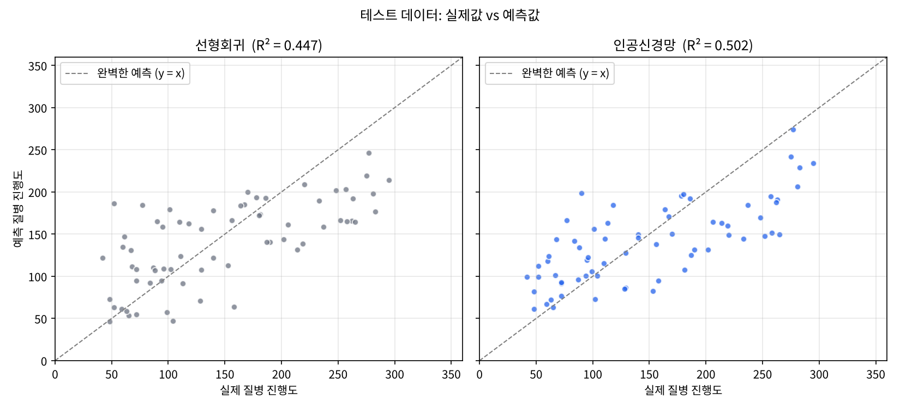
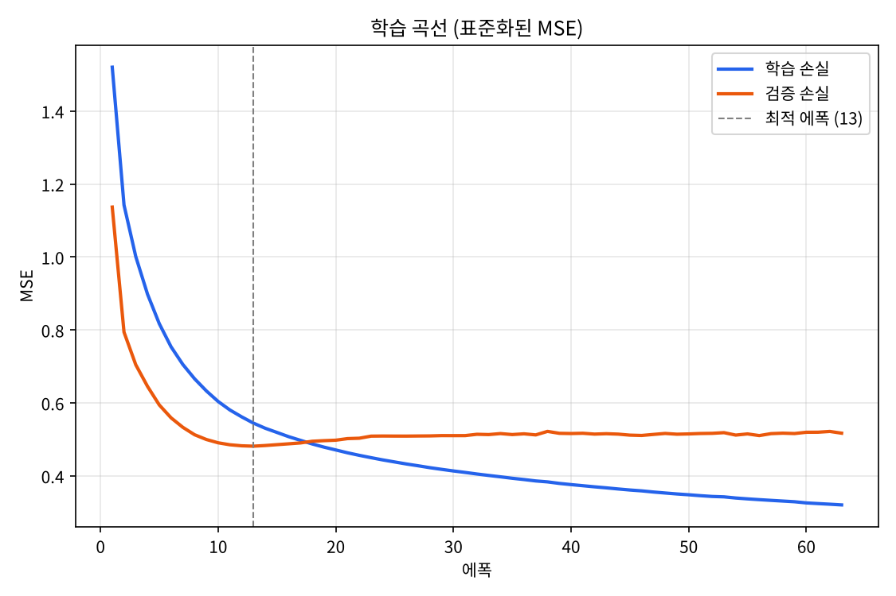

# 인공신경망으로 당뇨병 진행도 예측하기

공개 데이터셋(Diabetes, 환자 442명)의 건강 지표 10가지로 **1년 뒤 당뇨병 진행 정도**를 예측하는 인공신경망(MLP)입니다.
TensorFlow·PyTorch 없이 **NumPy만으로 순전파 · 역전파 · Adam 최적화를 직접 구현**했고, 선형회귀와 성능을 비교했습니다.

### 🧮 [웹 계산기 열기 → baekjiwoong5.github.io/-2](https://baekjiwoong5.github.io/-2/)

건강 지표를 입력하면 인공신경망과 선형회귀의 예측값이 바로 나오고, 신경망 내부가 어떻게 반응하는지 볼 수 있습니다.

## 결과

테스트 데이터(학습에 쓰지 않은 환자 67명) 기준입니다.

| 모델 | MAE ↓ | RMSE ↓ | R² ↑ |
|---|---:|---:|---:|
| 평균값만 예측 (기준선) | 66.45 | 75.54 | -0.005 |
| 선형회귀 | 45.57 | 56.03 | 0.447 |
| **인공신경망** | **43.69** | **53.19** | **0.502** |





- 최대 1000 에폭 중 **63 에폭에서 조기 종료**, 검증 손실이 가장 낮았던 **13 에폭**의 가중치를 최종 모델로 사용
- 13 에폭 이후 학습 손실은 계속 줄지만 검증 손실은 오히려 늘어남 → 과적합의 신호이며, 조기 종료가 이를 막음
- 인공신경망이 세 지표 모두에서 선형회귀보다 우수. 다만 R² 0.502는 진행도 변동의 약 절반만 설명한다는 뜻

## 데이터

**scikit-learn Diabetes 데이터셋** (Efron et al., 2004, *Least Angle Regression*). [`data/diabetes.csv`](data/diabetes.csv)에 원래 단위 그대로 저장했습니다.

| 열 | 의미 | 범위 |
|---|---|---|
| `age` | 나이 (세) | 19 ~ 79 |
| `sex` | 성별 (데이터에 1, 2로만 기록) | 1, 2 |
| `bmi` | 체질량지수 | 18.0 ~ 42.2 |
| `bp` | 평균 혈압 | 62 ~ 133 |
| `s1` | 총콜레스테롤 (TC) | 97 ~ 301 |
| `s2` | LDL | 41.6 ~ 242.4 |
| `s3` | HDL | 22 ~ 99 |
| `s4` | TC/HDL 비율 | 2.00 ~ 9.09 |
| `s5` | 중성지방 로그값 | 3.26 ~ 6.11 |
| `s6` | 혈당 | 58 ~ 124 |
| `progression` | **목표값**: 1년 후 질병 진행 정도 | 25 ~ 346 |

학습 309명 (70%) / 검증 66명 (15%) / 테스트 67명 (15%)으로 나눴습니다.

## 모델


학습 파라미터: (10×32+32) + (32×16+16) + (16×1+1) = **897개**

| 단계 | 방법 | 설명 |
|---|---|---|
| 전처리 | 표준화 | 학습 데이터의 평균·표준편차로 x' = (x − μ) / σ. 테스트 정보가 섞이지 않게 학습 데이터만 사용 |
| 초기화 | He 초기화 | W ~ N(0, √(2/n_in)). ReLU가 신호 절반을 0으로 만들어도 크기가 유지됨 |
| 순전파 | z = aW + b, a = ReLU(z) | 출력층은 활성화 함수 없이 실수값을 그대로 출력 (회귀) |
| 손실 | MSE + L2 | L = (1/n)Σ(ŷ − y)² + (λ/2)Σ‖W‖², λ = 0.001 |
| 역전파 | 연쇄법칙 | 출력 오차 δ = 2(ŷ − y)/n 을 입력층 방향으로 전달, ReLU 미분(z > 0 → 1, 아니면 0) 적용 |
| 최적화 | Adam | 학습률 0.001, β₁ 0.9, β₂ 0.999. 기울기의 이동평균과 제곱 이동평균으로 파라미터별 학습률 조절 |
| 학습 | 미니배치 | 배치 32, 매 에폭 데이터 섞기 |
| 과적합 방지 | 조기 종료 | 검증 손실이 50 에폭 동안 개선되지 않으면 멈추고 최적 가중치로 복원 |


## 웹 계산기 켜기

`index.html`은 학습된 신경망 가중치를 파일 안에 담고 있어서, 서버나 인터넷 연결 없이 **브라우저만으로 예측**합니다.
값을 바꾸면 신경망·선형회귀의 예측값과 신경망 내부(노드 활성화)가 함께 바뀌고, "환자 1~6" 버튼으로 테스트 데이터의 실제 환자와 비교할 수 있습니다.

1. 저장소를 **Public**으로 둡니다. (무료 계정은 Private 저장소에서 Pages를 쓸 수 없습니다)
2. **Settings → Pages → Build and deployment**에서 Source를 **Deploy from a branch**, Branch를 **main**, 폴더를 **/ (root)**로 고르고 **Save**
3. 1~2분 뒤 https://baekjiwoong5.github.io/-2/ 에서 계산기가 열립니다.

> 저장소에서 `index.html` 파일을 클릭하면 **코드가 보이는 것이 정상**입니다. 계산기는 위의 Pages 주소에서 열립니다.
> 내려받은 `index.html`을 더블클릭해서 바로 열어도 동작합니다.

## 실행 방법

```bash
git clone https://github.com/baekjiwoong5/-2.git
cd -- -2
pip install -r requirements.txt

python ann_diabetes_predictor.py            # 학습, 결과 출력, images/ 그래프와 model.json 저장
python ann_diabetes_predictor.py --show     # 그래프 창 띄우기
python ann_diabetes_predictor.py --predict 59 2 32.1 101 157 93.2 38 4 4.8598 87
                                            # 나이 성별 BMI 혈압 s1~s6 순서로 넣으면 진행도 예측
```

`--predict` 예시(데이터 첫 번째 환자, 실제 진행도 151)의 출력:

```
예측 질병 진행도  인공신경망 174.8  /  선형회귀 209.7
```

## 폴더 구조

```
├── ann_diabetes_predictor.py   # 데이터 처리 · 신경망 · 학습 · 평가 · 예측 · 그래프
├── model.json                  # 학습된 가중치와 표준화 값 (--predict에서 사용)
├── index.html                  # 웹 계산기 (GitHub Pages 첫 화면, 가중치 내장)
├── requirements.txt
├── README.md
├── data/
│   ├── diabetes.csv
│   └── diabetes.xlsx
└── images/
    ├── learning_curve.png
    └── prediction.png
```

## 한계

- **작은 데이터**: 442명은 신경망에 작은 규모라 13 에폭 만에 과적합이 시작됨
- **평가 안정성**: 테스트 67명으로는 분할에 따라 결과가 달라질 수 있음 → K-겹 교차검증으로 보완 가능
- **극단값**: 실제 진행도가 높은(250 이상) 환자는 낮게 예측하는 경향
- 학습용 과제이며 의료적 판단에 쓸 수 없음

## 참고 자료

- Efron, B., Hastie, T., Johnstone, I., & Tibshirani, R. (2004). Least Angle Regression. *Annals of Statistics*, 32(2), 407–499.
- [scikit-learn: Diabetes dataset](https://scikit-learn.org/stable/datasets/toy_dataset.html#diabetes-dataset)
- Kingma, D. P., & Ba, J. (2015). Adam: A Method for Stochastic Optimization. *ICLR*.
- He, K. et al. (2015). Delving Deep into Rectifiers. *ICCV*.
- Rumelhart, D. E., Hinton, G. E., & Williams, R. J. (1986). Learning representations by back-propagating errors. *Nature*, 323, 533–536.
